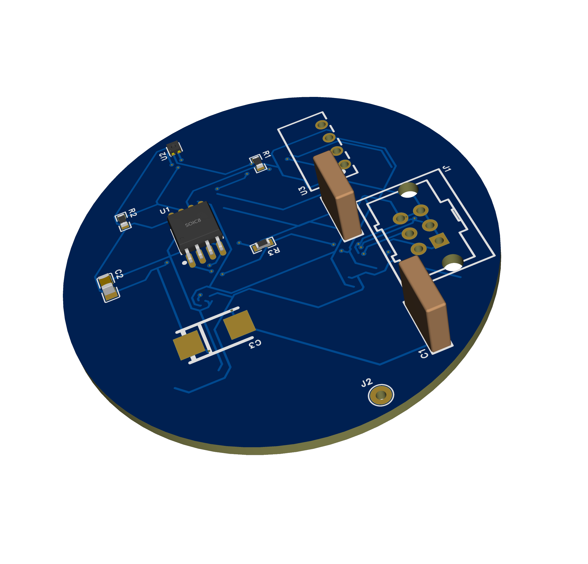
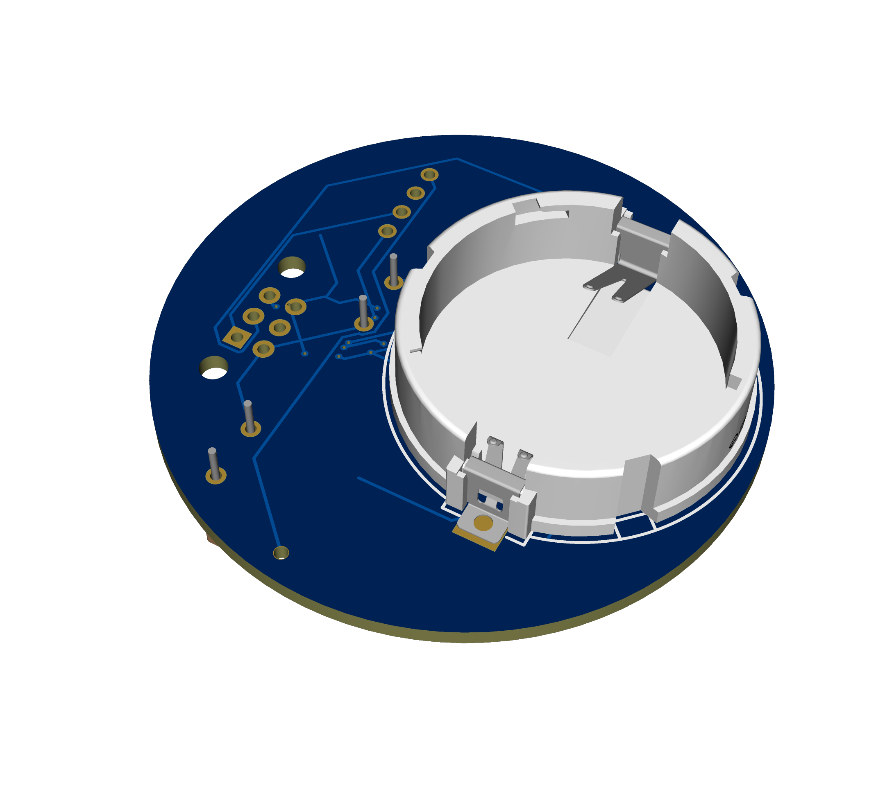

# ATtiny85 Temperature / Humidity Sensors

Battery-powered sensor nodes (ATtiny85 + SHT40 or HTU21D + 433 MHz transmitter on 2×AA)
reporting every ~5 minutes to an ESP32 receiver that publishes to MQTT with
Home Assistant auto-discovery. Estimated battery use is ~140–150 mAh a year, so a
pair of AAs lasts several years. See [Sensors](docs/sensors.md) for choosing
between the SHT40 and the HTU21D (GY-21) used for the proof of concept.

Split from [AtTinyWeatherStation](https://github.com/jointine-john/AtTinyWeatherStation), which continues as an ATtiny84 wind and rain station. Both
projects share the radio protocol, so one receiver can hear both kinds of node.

```
 [ATtiny85 + sensor + STX882] ))) 433.92 MHz OOK ))) [RXB6/SRX882 + ESP32] --WiFi--> MQTT --> Home Assistant
```

## PCB (in progress)

A round coin-cell board is being laid out in EasyEDA, with the parts on top and
the CR2450 holder underneath. See [Hardware](hardware/README.md) for the
schematic files and footprints.

| Top | Bottom |
|---|---|
|  |  |

## Documentation

| | Page | Contents |
|---|---|---|
| 1 | [Parts](docs/parts.md) | Bill of materials and UK shopping list |
| 2 | [Sensors](docs/sensors.md) | SHT40 vs HTU21D (GY-21), which firmware to build, board notes, troubleshooting |
| 3 | [Wiring](docs/wiring.md) | Schematics, stripboard layout, receiver wiring (RXB6/SRX882), antennas |
| 4 | [Programming the ATtiny85](docs/programming.md) | USBasp, ArduinoISP and SparkFun programmer wiring, troubleshooting |
| 5 | [Building and flashing](docs/building.md) | Build options, node IDs, battery calibration, receiver setup, Home Assistant, loopback and decoder tests |
| 6 | [Power budget](docs/power.md) | Battery life estimate, tuning, measuring sleep current |
| 7 | [Radio protocol](docs/protocol.md) | Frame format, typed readings (T/H, pressure, wind, rain), reliability |
| 8 | [Future plans](docs/future-plans.md) | Coin-cell power, PCB for EasyEDA, case, receiver pressure sensor |

## Quick start

```sh
# Sensor node (ATtiny85 on a USBasp; add "-e sht40" for an SHT40 board)
cd sensor-node
pio run -t fuses
PLATFORMIO_BUILD_FLAGS="-DNODE_ID=1" pio run -t upload

# Receiver (ESP32)
cd ../receiver
cp src/secrets.example.h src/secrets.h   # fill in WiFi + MQTT
pio run -t upload && pio device monitor
```

## Repository layout

| Path | What |
|---|---|
| `common/protocol.h` | Over-the-air packet format, shared by both ends |
| `sensor-node/` | ATtiny85 firmware (bare avr-gcc via PlatformIO, no Arduino core) |
| `receiver/` | ESP32 firmware (Arduino via PlatformIO) |
| `hardware/` | PCB schematic (EAGLE and KiCad) for EasyEDA, footprints, renders |
| `test/` | PC test of the Manchester decoder against noisy, jittered signals |
| `docs/` | Documentation |
