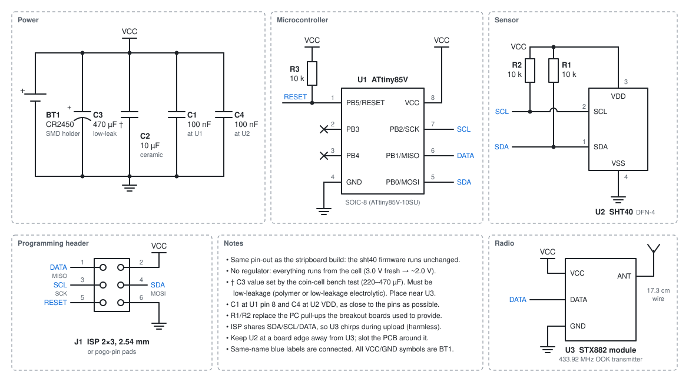

# Future plans

Nothing on this page is built yet. It records where the sensor node is headed
after the stripboard proof of concept: a custom PCB, an enclosure, and coin-cell
power. It also covers a sensor on the ESP32 receiver itself, and a wind and
rain station built on the larger ATtiny84.

## Goals

1. Run the sensor node from a single **CR2450** coin cell instead of 2×AA.
2. Replace the stripboard with a **PCB** designed in EasyEDA and ordered from
   JLCPCB (optionally with assembly).
3. Design a **case** that fits the PCB and cell, and suits indoor and sheltered
   outdoor use.
4. Have the **ESP32 receiver** record its own temperature, humidity and
   **pressure**, published to Home Assistant alongside the nodes.
5. Port the node firmware to the **ATtiny84**, which has the pins a weather
   station needs.
6. Build a **wind and rain station**: wind speed, gust and direction, and
   rainfall from a tipping-bucket gauge.

The cell is a **CR2450** (24.5 mm × 5.0 mm, ~620 mAh, 3 V lithium).

## 1. Coin-cell power

### Budget

From [Power budget](power.md), the node uses about 140 mAh a year with an
SHT40. On a CR2450:

| Cell | Capacity | Estimated life |
|---|---|---|
| CR2450 | ~620 mAh | ~4 years on paper, less in the cold |
| CR2032 (for comparison) | ~220 mAh | ~1.5 years |

The ~92 mAh a year spent on the transmitter is the biggest item, so it is the
first thing to cut if life falls short.

### The pulse-current problem

The STX882 draws about 15 mA for around 360 ms per report (3 frames). A coin
cell's internal resistance (tens of ohms, rising with age and cold) makes the
voltage sag under that load, which can reset the ATtiny or corrupt a frame.

Mitigations to evaluate:

- **Reservoir capacitor** across the cell, e.g. 220–470 µF. It must be
  low-leakage (polymer or low-leakage tantalum/electrolytic); a leaky capacitor
  can draw more than the whole sleeping circuit.
- **Fewer repeats:** lower `PROTO_REPEATS` in `common/protocol.h` from 3 to 2
  (cuts TX energy by a third, at some cost to reliability).
- **Longer interval:** raise `INTERVAL_S` in `sensor-node/platformio.ini`.
- **Gap between frames:** sleep briefly between repeats so the capacitor can
  recharge.
- **Brown-out detection:** confirm the BOD fuse setting is sensible for a
  ~2.0 V end point.

### Bench test before the PCB

1. Power the current stripboard build from a CR2450 in a holder.
2. Scope or log the supply rail during a transmit burst, with and without the
   reservoir capacitor.
3. Check the receiver still decodes every report, including with a part-used
   cell and in a fridge (cold test).
4. Measure sleep current (expect about 5 µA, see [Power budget](power.md)).

Exit criterion: no resets or lost reports with a part-used cell and the
chosen capacitor.

## 2. PCB (EasyEDA → JLCPCB)

### Design choices

- **Sensor on the board:** a bare SHT40 (DFN-4) instead of a breakout. This
  drops the breakout's LED and regulator, and the HTU21D/GY-21 build stays
  stripboard-only.
- **MCU:** ATtiny85 in SOIC-8 (ATtiny85V preferred, rated to 1.8 V), or keep a
  DIP socket for easy reflashing.
- **Transmitter:** keep the STX882 module, soldered flat or on headers, rather
  than designing an RF stage.
- **Antenna:** 17.3 cm wire from a pad, or a PCB/helical antenna if the case
  is too small (expect some range loss).
- **Programming:** a 6-pin ISP footprint (or pogo-pin pads) so boards can be
  reflashed in place.
- **Cell holder:** SMD CR2450 holder on the back of the board.
- **Passives:** 100 nF decoupling, the reservoir capacitor from the bench test,
  and 10 kΩ I²C pull-ups (the breakouts provided these before).
- **Thermal isolation:** keep the SHT40 at the board edge, away from the
  transmitter, with slots in the board to reduce heat coupling.
- **Parts:** pick from the JLCPCB/LCSC basic parts list where possible to keep
  assembly cheap.

### Schematic (draft)

The pin-out is the same as the stripboard build, so the `sht40` firmware runs
unchanged. Draft parts list:

| Ref | Part | Package (suggested) |
|---|---|---|
| BT1 | CR2450 holder | SMD, from the LCSC catalogue |
| C1, C4 | 100 nF ceramic | 0603 |
| C2 | 10 µF ceramic | 0805 |
| C3 | 220–470 µF low-leakage, value from the bench test | Polymer or electrolytic, SMD |
| R1, R2, R3 | 10 kΩ | 0603 |
| U1 | ATtiny85V-10SU | SOIC-8 |
| U2 | SHT40-AD1B | DFN-4 (1.5 × 1.5 mm) |
| U3 | STX882 module | 4-pin header or castellated pads |
| J1 | ISP header | 2×3, 2.54 mm, or pogo-pin pads |

### Steps

1. Enter this schematic in EasyEDA.
2. Lay out the board, sized to fit the cell holder.
3. Order a small batch of bare boards first, hand-assemble one and repeat the
   bench test.
4. Add the schematic and Gerbers to the repo (e.g. `hardware/`).

## 3. Case

- Sized around the PCB, cell holder and antenna.
- Vents or a membrane so the sensor sees outside air, with the electronics
  shielded from direct rain and sun (a Stevenson-screen style louvred design
  for outdoor nodes).
- Easy access to change the cell.
- 3D-printed (PETG or ASA for outdoor UV resistance).
- Store the model files in the repo alongside the PCB files.

## 4. Receiver sensor (temperature, humidity, pressure)

The receiver is mains-powered, so power use doesn't matter here.

### Sensor choice

- **BME280** (recommended): temperature, humidity and pressure in one I²C
  chip, on cheap breakout boards. Buy from a reputable seller: many boards
  sold as "BME280" carry a BMP280, which has no humidity sensor. The firmware
  should check the chip ID (0x60 for BME280, 0x58 for BMP280) and log a clear
  error.
- **Alternative:** SHT40 for temperature and humidity plus a BMP280/BMP390 for
  pressure, on the same I²C bus. More accurate humidity (±1.8% vs ±3% RH), and
  it matches the nodes' sensor, at the cost of a second board.

### Wiring

- I²C on the ESP32 defaults: **SDA → GPIO21, SCL → GPIO22**, VCC → 3V3,
  GND → GND. GPIO4 stays the 433 MHz receiver input.
- Most BME280 boards already have I²C pull-ups.
- **Self-heating:** the ESP32 and its WiFi radio warm the board by a few °C.
  Mount the sensor on a short lead outside or below the receiver's case, away
  from the ESP32 and any regulator.

### Firmware

- Read the sensor every 60 s, in forced mode so it sleeps between readings
  (less self-heating).
- Publish over the existing MQTT connection as its own Home Assistant device
  (e.g. "Receiver"), with Home Assistant auto-discovery like the nodes:
  temperature (°C), humidity (%) and pressure (hPa, device class
  `atmospheric_pressure`).
- Optionally report sea-level pressure as well, using a configured altitude
  (in `secrets.h`), so readings match weather forecasts.
- Use an existing library (e.g. Adafruit BME280) via `lib_deps` in
  `receiver/platformio.ini`.
- Keep it optional: if no sensor answers at start-up, log it and carry on
  receiving, so receivers without a sensor still work.

## 5. ATtiny84

The ATtiny85 has only two free pins (PB3, PB4) once I²C and the radio are
connected. A wind and rain station needs four: anemometer, rain gauge, vane
input and a pin to power the vane. The **ATtiny84** has the same AVR core,
the same low sleep current and the same 8 KB flash, with 11 I/O pins in a
14-pin package (DIP-14 for stripboard, SOIC-14 for the PCB). The ATtiny84A is
the current part number; it runs down to 1.8 V at 1 MHz.

The temperature/humidity nodes stay on the ATtiny85. The ATtiny84 is only for
nodes that need the extra pins.

### Pin plan

The I²C and radio lines go on the ISP pins, as on the ATtiny85, so the board
can still be reprogrammed in place.

| Pin | Port | Use |
|---|---|---|
| 1 | VCC | Supply |
| 2 | PB0 | Anemometer reed switch (PCINT8) |
| 3 | PB1 | Spare |
| 4 | PB3 | RESET (ISP) |
| 5 | PB2 | Spare |
| 6 | PA7 | Spare |
| 7 | PA6 | I²C SDA / ISP MOSI |
| 8 | PA5 | Radio DATA / ISP MISO |
| 9 | PA4 | I²C SCL / ISP SCK |
| 10 | PA3 | Rain gauge reed switch (PCINT3) |
| 11 | PA2 | Spare |
| 12 | PA1 | Wind vane divider power (high only while reading) |
| 13 | PA0 | Wind vane input (ADC0) |
| 14 | GND | Ground |

The anemometer and rain gauge are on different ports, so each gets its own
pin-change interrupt vector and the firmware never has to work out which one
fired.

### Porting the firmware

The code is small and mostly portable. What changes:

- **Pin definitions:** `radio.c`, `i2c.c` and `main.c` use `PORTB`/`DDRB`/`PINB`
  and fixed bit numbers. Move these into a per-board header (`board.h`)
  selected by the PlatformIO environment.
- **Register names:** the watchdog control register is `WDTCSR` on the
  ATtiny84 (`WDTCR` on the ATtiny85).
- **Battery reading:** the ADC channel for the internal 1.1 V reference is
  different (`MUX5:0 = 100001` on the ATtiny84).
- **Build:** add an `attiny84` board and fuse settings in
  `sensor-node/platformio.ini`, alongside the existing `htu21d` and `sht40`
  environments.
- The radio protocol needs no change: wind and rain readings are already
  defined (see [Radio protocol](protocol.md#readings)).

## 6. Wind and rain station

### Hardware

- **Sensors:** a hobby weather-meter kit, e.g. SparkFun SEN-15901 (or the
  Misol parts it is based on). It has a cup anemometer, a wind vane and a
  tipping-bucket rain gauge, all passive reed switches and resistors, on
  RJ11 plugs. Check the kit's datasheet for the RJ11 pin-out.
- **Temperature/humidity:** an SHT40 in a separate radiation shield, so the
  station reports T/H too.
- **MCU and radio:** ATtiny84 and STX882, as above.
- **Mounting:** on a mast in the open, so check the radio range to the
  receiver from there.

### Wind speed

- The anemometer closes a reed switch once per revolution; for the SparkFun
  kit, one closure per second is 2.4 km/h (0.667 m/s).
- A pin-change interrupt counts closures. It wakes the ATtiny from power-down
  for a few microseconds per pulse, so counting costs almost nothing.
- The watchdog wakes the node every second. Each second's count goes into a
  3-second rolling sum; the highest one in the interval is the **gust**
  (3 s is the standard gust averaging time). The total over the interval
  gives the **average speed**.
- **Pull-up:** the cups can stop with the switch closed, so the internal
  pull-up (~35 kΩ, ~85 µA when closed) wastes too much. Use an external
  1 MΩ pull-up (3 µA worst case) with 1 nF to ground for debouncing
  (1 ms time constant, fast enough for gale-force pulse rates), plus a short
  software lock-out.
- **Accuracy:** the watchdog's timing is only accurate to about ±10%, so wind
  speed is too. Add a calibration constant (`WDT_CAL`), measured once per
  chip with a scope or by timing many watchdog periods, as `BANDGAP_MV`
  already does for the battery reading.

### Wind direction

- The vane switches in one of 16 resistor combinations. With a 10 kΩ resistor
  from PA1, PA0 reads one of 16 voltages; a lookup table maps the ADC reading
  to a direction (the table is in the kit datasheet).
- PA1 powers the divider for about a millisecond per reading. Left on, it
  would draw up to ~300 µA.
- Sample once per second. Report the vector average of the interval's
  samples (16-entry sine/cosine table, integer maths), or the most common of
  the 16 positions as a simpler first version.
- Sent as deci-degrees, so 16 positions come out as multiples of 22.5°.

### Rain

- The bucket tips once per 0.2794 mm of rain (SparkFun kit) and closes a reed
  switch briefly as it passes.
- A pin-change interrupt counts tips into a running 16-bit count. The node
  sends that count with the bucket size (279 µm), as the protocol already
  defines. A lost packet loses no rain; Home Assistant adds it up as a
  `total_increasing` sensor.
- Same 1 MΩ pull-up as the anemometer, with 10 nF (10 ms) debounce and a
  software lock-out of ~100 ms, since contacts can bounce for several
  milliseconds as the bucket tips.

### Power

A station frame with T/H, wind (speed, gust, direction) and rain has 24 body
bytes, 31 bytes on air, about 250 ms per frame.

| Reporting interval | Transmitter | Total (approx.) | 2×AA lithium (~3000 mAh) |
|---|---|---|---|
| 5 minutes | ~165 mAh/year | ~230 mAh/year | Shelf life is the limit |
| 1 minute | ~820 mAh/year | ~890 mAh/year | ~3 years |

The 1-second watchdog ticks and pulse counting add only a few µA. Wind
changes quickly, so a 1-minute interval is worth considering here: 2×AA
lithium cells (Energizer L91, good in the cold) still last years. A CR2450 is
not suitable: the longer frames make its pulse-current problem worse. A small
solar panel with a supercapacitor is an option if batteries in a mast-top
box are awkward to change.

### Steps

1. Port the firmware to the ATtiny84 (section 5) and check a T/H-only build
   against the receiver.
2. Add anemometer and rain counting on a breadboard, then check pulse counts
   against hand-turned cups and a measured volume of water poured through the
   gauge.
3. Add the vane, build the ADC lookup table from real readings, and check all
   16 positions.
4. Calibrate the watchdog (`WDT_CAL`) and anemometer factor.
5. Use the receiver's loopback test meanwhile: it already sends wind and rain
   readings, so the Home Assistant side can be set up in advance.
6. Design a station PCB (ATtiny84, SHT40 header, two RJ11 jacks, pull-ups and
   debounce capacitors, AA holder) and a mast-mount case.

## Open questions

- Target battery life: what is the minimum acceptable?
- Indoor only, or outdoor too? This drives the case design and whether cold
  performance matters.
- Hand-solder or JLCPCB assembly? This decides SOIC/DFN vs through-hole parts.
- Wire antenna or PCB antenna?
- Receiver sensor: BME280 alone, or SHT40 + BMP280/BMP390? Indoors with the
  receiver, or on a lead outside?
- Wind and rain: which kit? How often should the station report (1 or
  5 minutes)? AA lithium or solar?
- Where will the mast go, and is the radio range to the receiver enough?
