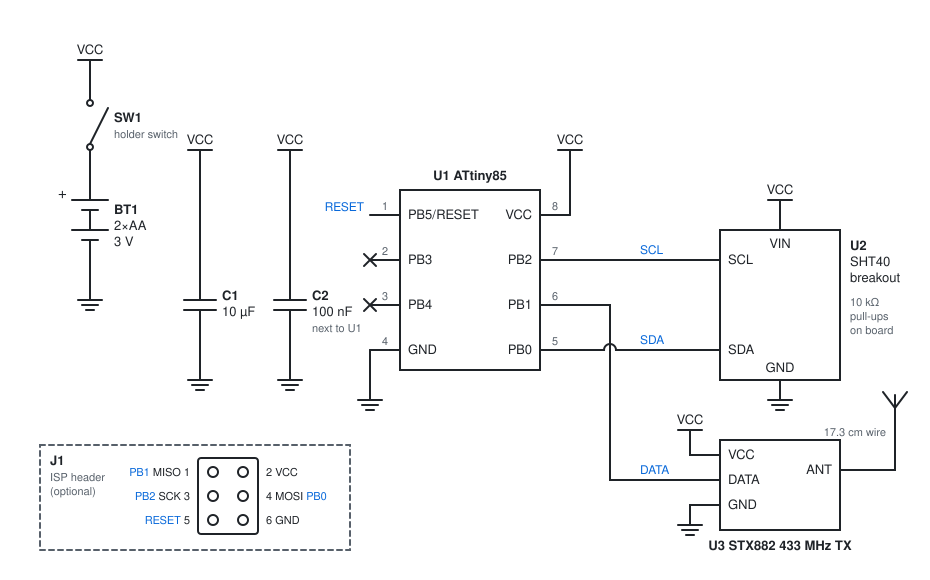
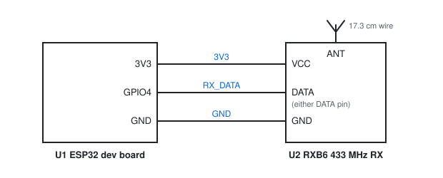

# Wiring

## Sensor node



VCC and GND symbols all join the same battery rails. Blue labels are net names:
pins with the same label are connected (J1 is wired to U1 this way).

Pin-level summary:

```
                 ATtiny85
              +-----\/-----+
   (ISP RST) -| 1 PB5  VCC 8|- Battery +  --- 100nF --- GND
     unused  -| 2 PB3  PB2 7|- SHT40 SCL
     unused  -| 3 PB4  PB1 6|- STX882 DATA
        GND  -| 4 GND  PB0 5|- SHT40 SDA
              +-------------+

 SHT40 VIN -> Battery +      STX882 VCC -> Battery +
 SHT40 GND -> GND            STX882 GND -> GND, ANT -> 17.3 cm wire
```

Fit the 10 µF capacitor across the battery terminals.

No voltage regulator: everything runs straight off the cells (3.2 V fresh → ~2.0 V flat).
The transmitter draws nothing measurable while its DATA pin is low.

PB0/PB1/PB2 double as the ISP MOSI/MISO/SCK pins, so you can reprogram in-circuit
(the transmitter will chirp during upload, which is harmless). See
[Programming the ATtiny85](programming.md#reprogramming-a-finished-sensor-in-place).

## Receiver



| RXB6 | ESP32 |
|---|---|
| VCC | 3V3 |
| GND | GND |
| DATA (either DATA pin) | GPIO4 |
| ANT | 17.3 cm wire |

To use a different GPIO, change `RX_PIN` in `receiver/src/main.cpp`.

## Antennas

A straight 17.3 cm piece of solid-core wire (a quarter wavelength at 433.92 MHz)
on both transmitter and receiver. Keep it straight and away from the batteries
and ground wiring where possible; range drops sharply with no antenna at all.
